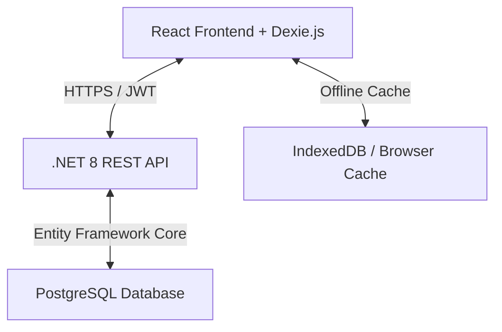
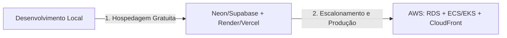

# Especificação de Arquitetura e Tecnologia - Market List

Este documento descreve a infraestrutura técnica, arquitetura de software, modelagem de dados e estratégias de sincronização offline-first do sistema **Market List**.

---

## 1. Arquitetura de Alto Nível

O Market List utiliza uma arquitetura baseada em **Monorepo**, facilitando a gestão do versionamento e do deploy. A aplicação é dividida em três pilares principais:



*   **Frontend Mobile/Web/Desktop:** React (Vite) empacotado para web estática. Utiliza **Dexie.js** como banco local (IndexedDB) para armazenamento seguro e reativo no dispositivo, permitindo operações offline instantâneas.
*   **Backend API:** C# .NET 8 implementado sob a arquitetura de camadas de negócio (Business) e repositórios (Repository) utilizando Entity Framework Core para comunicação com o banco.
*   **Banco de Dados:** PostgreSQL para armazenamento centralizado e persistente das informações de todos os usuários, itens, ambientes e agrupamentos.

---

## 2. Stack Tecnológica

| Componente | Tecnologia | Função |
| :--- | :--- | :--- |
| **Frontend** | React 18, Vite | Interface Web responsiva de alta fidelidade visual (glassmorphic) |
| **Banco Local** | Dexie.js (IndexedDB) | Cache local offline-first síncrono e reativo no navegador/app |
| **Icons** | Lucide React | Biblioteca de ícones vetoriais modernos |
| **Backend** | .NET 8 (C#) | API RESTful com autenticação JWT e validação de tokens sociais |
| **ORM** | Entity Framework Core | Mapeador objeto-relacional para comunicação com banco de dados |
| **Banco Central** | PostgreSQL 15 | Banco de dados relacional de produção |
| **Containers** | Docker, Docker-Compose | Padronização de build e execução de containers locais |
| **Orquestração** | Helm (Kubernetes) | Templates YAML para deploy rápido e modularizado |
| **CI/CD** | GitHub Actions | Compilação automática, execução de testes unitários e push para o GHCR |

---

## 3. Modelagem do Banco de Dados (PostgreSQL)

O banco de dados relacional é estruturado a partir de entidades com relacionamentos mapeados no EF Core. A seguir, destacamos as principais tabelas:

*   **`Usuario`:** Armazena credenciais (hash de senha) e informações de login social.
*   **`Unidade`:** Ambientes de origem das listas de compras (Lojas, residências).
*   **`UsuarioUnidade`:** Tabela de junção muitos para muitos que vincula usuários às suas unidades.
*   **`Sessao`:** Mercados onde as compras são feitas.
*   **`Setor`:** Corredores/sessões internas associadas a uma `Sessao`.
*   **`Item`:** Produtos cadastrados associados a unidades, sessões (mercados) e setores.
*   **`Lista`:** Cabeçalho das listas de compras vinculadas a uma `Unidade`.
*   **`ItemLista`:** Itens que compõem uma `Lista` com quantidade, preço unitário (`NPreco`), status de compra (`NIdStatus`) e dados do comprador.
*   **`AgrupadorListas` (Agrupador):** Agrupamento físico/lógico de múltiplas listas de compras.
*   **`ListaAgrupadorListas` (ListaAgrupador):** Tabela de associação muitos para muitos entre o `Agrupador` e as `Lista` correspondentes.

---

## 4. Estratégia Offline-First (Dexie.js / IndexedDB)

Para garantir que o app funcione 100% sem internet, a persistência local em IndexedDB gerencia o fluxo de escrita imediata.

### 4.1. Mapeamento de Schemas no Dexie
O arquivo [db.js](file:///d:/Nino%20Programas/Market%20List/Market_List_Front/src/db/db.js) inicializa a instância com o seguinte schema:
```javascript
db.version(1).stores({
  listas: '++id, idRemote, nome, unidadeId, syncStatus',
  itens: '++id, idRemote, nome, sessaoId, unidadeId, setorId, syncStatus',
  itensLista: '++id, idRemote, listaId, itemId, syncStatus',
  ambientes: '++id, idRemote, nome, syncStatus',
  mercados: '++id, idRemote, nome, syncStatus',
  setores: '++id, idRemote, nome, sessaoId, syncStatus'
});
```

*   **`id`:** Chave primária local auto-incremento (inteiro) gerada pelo IndexedDB.
*   **`idRemote`:** ID retornado pelo PostgreSQL correspondente após a sincronização com o servidor. Usado para atualizar referências locais.
*   **`syncStatus`:** Status de controle da sincronização:
    *   `'synced'`: Dados idênticos aos do servidor.
    *   `'created'`: Registro criado localmente em modo offline que aguarda envio.
    *   `'updated'`: Registro modificado offline que aguarda envio das atualizações.
    *   `'deleted'`: Registro excluído offline que aguarda exclusão no banco remoto.

---

## 5. Algoritmo do Sincronizador Automático (Sync Queue)

O arquivo [syncService.js](file:///d:/Nino%20Programas/Market%20List/Market_List_Front/src/services/syncService.js) gerencia a ordem lógica de sincronização para manter a integridade referencial:

1.  **Ordem Lógica das Operações:**
    1.  **Ambientes (Unidade):** Cria no servidor para gerar IDs remotos reais e substitui os IDs locais temporários dependentes em `listas` e `itens`.
    2.  **Mercados (Sessao):** Cria e atualiza os mercados no servidor.
    3.  **Setores (Setor):** Cria os setores vinculando-os ao `idRemote` do mercado correspondente.
    4.  **Itens (Item):** Cria os produtos associando-os aos IDs remotos de Unidade, Mercado e Setor corretos.
    5.  **Listas (Lista):** Sobe os cabeçalhos de lista criados.
    6.  **Itens das Listas (ItemLista):** Envia em lote as modificações e exclusões dos itens de cada lista de compras de forma otimizada via endpoint `/ItemLista/Atualizar`.

2.  **Gatilhos de Execução:**
    *   **Monitor de Rede (App.jsx):** Dispara automaticamente ao detectar que o navegador reestabeleceu sinal (`window.addEventListener('online')`).
    *   **Inicialização do Aplicativo:** Roda no carregamento inicial se o dispositivo já estiver online.

---

## 6. Fluxo de CI/CD e Infraestrutura de Deploy

### 6.1. Docker e Docker-Compose
*   A API backend possui um `Dockerfile` multi-stage focado em compilar no SDK do .NET 8 e rodar em cima do runtime de produção `aspnet:8.0`.
*   O frontend possui um `Dockerfile` que roda a compilação estática do React e copia os ativos para servir em alta performance usando Nginx.
*   O arquivo `docker-compose.yml` une a API, o Frontend e uma imagem do PostgreSQL para subir todo o ambiente local integrado com apenas um comando.

### 6.2. Pipeline de CI/CD (GitHub Actions)
O arquivo [deploy.yml](file:///d:/Nino%20Programas/Market%20List/.github/workflows/deploy.yml) é responsável por:
*   Compilar a API e rodar a suíte de testes automáticos.
*   Compilar o Frontend React.
*   Montar as imagens Docker para ambas as aplicações e publicá-las automaticamente no **GitHub Container Registry (GHCR)** após cada push na branch `main`.

### 6.3. Helm Charts (Kubernetes)
A pasta `helm/marketlist` disponibiliza a infraestrutura de orquestração Kubernetes, incluindo deploys parametrizados para o backend e o frontend, além de um Ingress para direcionamento de tráfego de rotas web.

---

## 7. Hospedagem Gratuita vs AWS (Plano de Migração)



### 7.1. Fase Inicial: Hospedagem Gratuita
Para o período de desenvolvimento e testes fechados, a estrutura de nuvem gratuita deve ser:
*   **Banco PostgreSQL:** Neon.tech ou Supabase (plano free).
*   **API C#:** Render (Web Service Dockerizado gratuito).
*   **Frontend React:** Vercel ou Netlify (serviço estático gratuito de altíssima velocidade).

### 7.2. Fase Avançada: Migração para AWS
Quando o aplicativo for lançado no mercado comercial e exigir estabilidade, baixa latência e alta disponibilidade, a migração para a AWS é simplificada pela Dockerização prévia:
1.  **Database (RDS):** Migrar o banco Postgres do Supabase/Neon para o **Amazon RDS PostgreSQL** (para banco gerenciado clássico) ou **Amazon Aurora Serverless** (para economia sob demanda).
2.  **Backend API (ECS + Fargate):** Rodar a imagem Docker da API em **Amazon ECS com AWS Fargate**, obtendo computação serverless gerenciada extremamente escalável.
3.  **Frontend (S3 + CloudFront):** Implantar o build do React dentro do **Amazon S3** e expor globalmente através do **Amazon CloudFront** (CDN), garantindo custos próximos a zero para o tráfego estático.
4.  **Imagens Docker (ECR):** O pipeline CI/CD do GitHub Actions migra o push de imagem do GHCR para o **Amazon ECR**.
